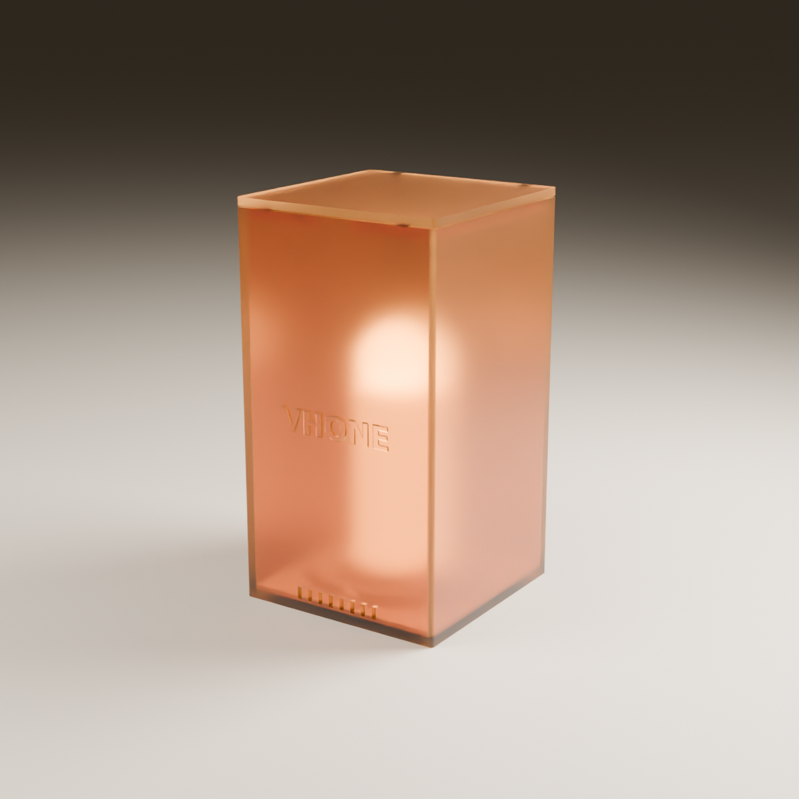
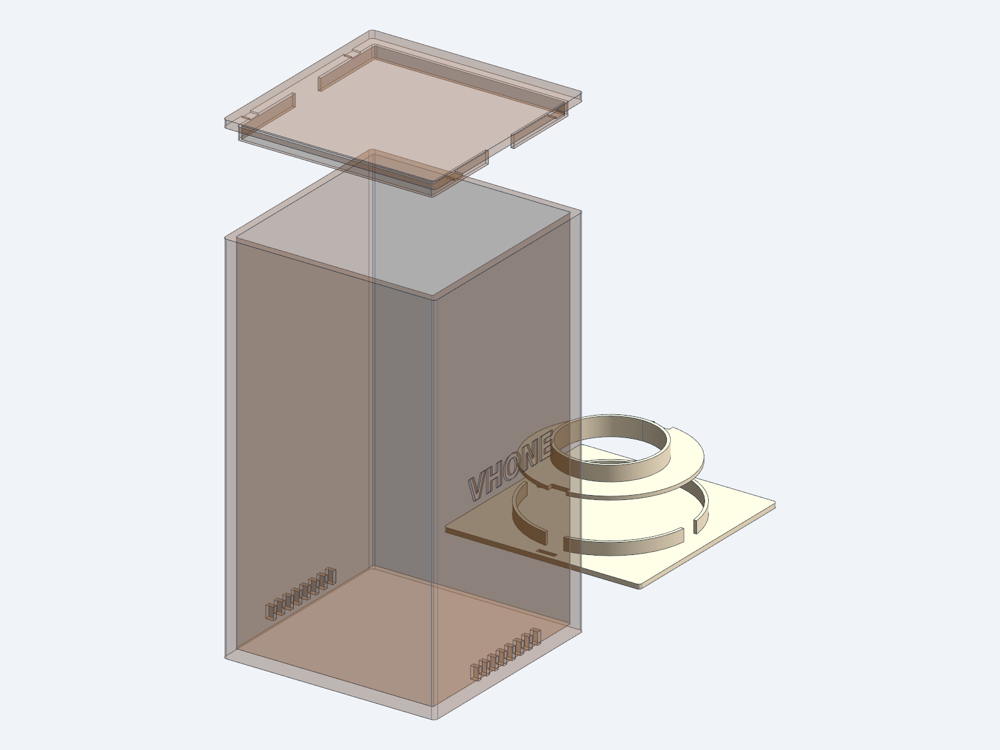

# AMBER / 01

Amber translucent rectangular battery-lamp enclosure, inspired by the tall rectangular reference in `[examples/cosmos_723682210.webp`](https://www.cosmos.so/e/723682210).

**Revision B — 140 × 140 × 256 mm**, plus 1.2 mm front emboss. **5 mm side walls, bottom and lid plate; raised VHONE lettering**. Lift-off lid and tray resized to the 130 mm interior; tray floor 3 mm; three optional sizing inserts. No electrical parts or mains wiring are included.

## Print-shop handoff

- Read `docs/lamp_specs.txt` for all dimensions, fit allowances, printing, assembly, source links and prototype limits.
- Print `STL/enclosure.stl`, `STL/lid.stl`, `STL/tray.stl`, plus only the insert needed for your chosen light.
- Use amber translucent PETG for the body and lid. Print all STLs at 100% in millimetres, in their supplied orientations.
- The 100 mm Bright Star BULB LED 298 candidate uses the tray without a reducer; the 60 mm adapter is a candidate for BULB LED 932 after measuring its actual foot.
- All six parts pass generic FDM/PETG checks; exported STLs pass edge-closure, winding, volume and dimension checks. Physical fit, stability, thermal operation and appearance remain prototype checks.

## Preview





## Interactive CAD models

These links use the local text-to-cad server. The STEP and STL files remain usable independently.
- [assembled](http://127.0.0.1:3245/881fed14-cdd0-5f8a-bb7f-686451c55427?token=4948351904.k1SLZ1UOd1a8Yt-bmQ8FPjpTXnNbT8XH2paFd3SIiwM)
- [exploded](http://127.0.0.1:3245/a114e2d0-c7c2-56b7-bc29-97331a0d73cd?token=4948351905.Bl8MnTxnWwKqqWcrMZwEaeTgmd7qhejDsw6hdPc4aco)
- [enclosure](http://127.0.0.1:3245/1d3676a8-b091-5dfb-bfa0-fefce3663592?token=4948351901.AfZQZnYv14JHS3rpvBvJVYU6a28EYBhcj2fXKrM50E0)
- [lid](http://127.0.0.1:3245/b094312f-6c31-556b-9898-a96fc2dd2698?token=4948351904.k1SLZ1UOd1a8Yt-bmQ8FPjpTXnNbT8XH2paFd3SIiwM)
- [tray](http://127.0.0.1:3245/19f1aa36-e698-5f38-9387-f361284e793d?token=4948351904.k1SLZ1UOd1a8Yt-bmQ8FPjpTXnNbT8XH2paFd3SIiwM)
- [adapter 60](http://127.0.0.1:3245/9600e500-2d48-51f1-9a51-4cf7b6bc66c8?token=4948351904.k1SLZ1UOd1a8Yt-bmQ8FPjpTXnNbT8XH2paFd3SIiwM)
- [adapter 70](http://127.0.0.1:3245/648b8ee9-7515-568f-9737-2b5ee7622ce6?token=4948351904.k1SLZ1UOd1a8Yt-bmQ8FPjpTXnNbT8XH2paFd3SIiwM)
- [adapter e27](http://127.0.0.1:3245/f89d6e58-546e-5e9a-99b0-cc5cf209a8a9?token=4948351904.k1SLZ1UOd1a8Yt-bmQ8FPjpTXnNbT8XH2paFd3SIiwM)

## Edit and rebuild

Source: `src/lamp.py`. Dimensions are at the top of the file. Requires text-to-cad.

```sh
cad run src/lamp.py
cad run src/check_lamp.py
cad run src/exports.py
python3 checks/validate_stl.py
```

Run each part’s `cad model dfm` command recorded in the source after changes; then run assembly interference. Re-export after editing, since exported files are snapshots. The appearance scene is `src/render_lamp.py`; it consumes `GLB/amber_01.glb`, which must also be re-exported after geometry changes.

CAD setup was initialized for this workspace. The already connected plugin works through the local CLI; restarting Codex loads any newly installed CAD integration.

No item was ordered, no print was started, and no seller was contacted.
